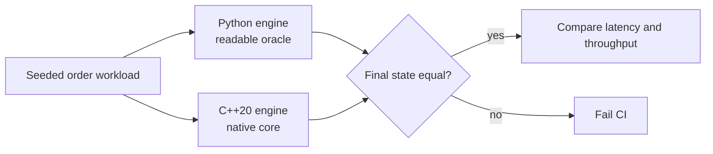

# Market Microstructure Engine

A limit order book that matches orders by price, then time, written twice: a C++20
engine for speed and a Python engine that checks it is correct.

## Result

**5.07M orders/s at p50 150 ns** on the C++20 engine, a median of 7 runs over
250,000 orders after 50,000 warmup orders (range 4.57M to 5.20M). In a paired run on
the same workload, Python measured 340,149 orders/s and C++20 measured 5.15M, about
15x, with matching final state.

| Latency | p50 | p95 | p99 | max |
|---|---:|---:|---:|---:|
| C++20 | 150 ns | 300 ns | 490 ns | 669,995 ns |

Measured on a Ryzen 7 9800X3D under WSL 2 with GCC 13.3, seed 42. The raw record is
[results/cpp20_benchmark_ryzen9800x3d.json](results/cpp20_benchmark_ryzen9800x3d.json),
and [docs/BENCHMARKS.md](docs/BENCHMARKS.md) covers the method and its limits. These
numbers are specific to this host.

## How it works



## Run it

```bash
cmake -S . -B build -DCMAKE_BUILD_TYPE=Release && cmake --build build --config Release --parallel
ctest --test-dir build --build-config Release --output-on-failure
python tools/compare_benchmarks.py --native build/mm_engine_benchmark --orders 25000 --warmup 5000
```

The Python engine runs on its own with `pip install -e .`, then
`python -m unittest discover -s tests`.

```python
from mm_engine import OrderBook, Side

book = OrderBook(symbol="FOO")
book.add_limit_order("ask-1", Side.SELL, price=10100, quantity=100)
trades = book.add_limit_order("buy-1", Side.BUY, price=10100, quantity=40)

print(trades[0].price, trades[0].quantity)
```

## Design decisions

1. **Two engines, one set of rules.** A fast engine with a subtle bug just produces
   wrong answers quickly. The Python version is the readable reference, and the
   C++ version has to match it.
2. **Parity before speed.** The benchmark compares final state across seeds first.
   A throughput number from an engine that disagrees with the oracle means nothing.
3. **Prices are integer ticks.** Floating-point prices can make two equal levels
   compare as different, so execution never touches a float.

## Limitations

- This is a matching engine, not an exchange. It has no network layer, persistence
  or risk checks.
- The workload is synthetic. Replaying real ITCH-style market data is future work.
- The p50 is excellent but the maximum is about 670 µs. That tail has not been
  investigated with hardware counters, and WSL adds noise.
- Price levels have not been compared against flat, cache-aware structures yet.

## More

- [Benchmark method](docs/BENCHMARKS.md)
- [Design notes](DESIGN.md)
- [Microstructure notes](MICROSTRUCTURE_NOTES.md)
